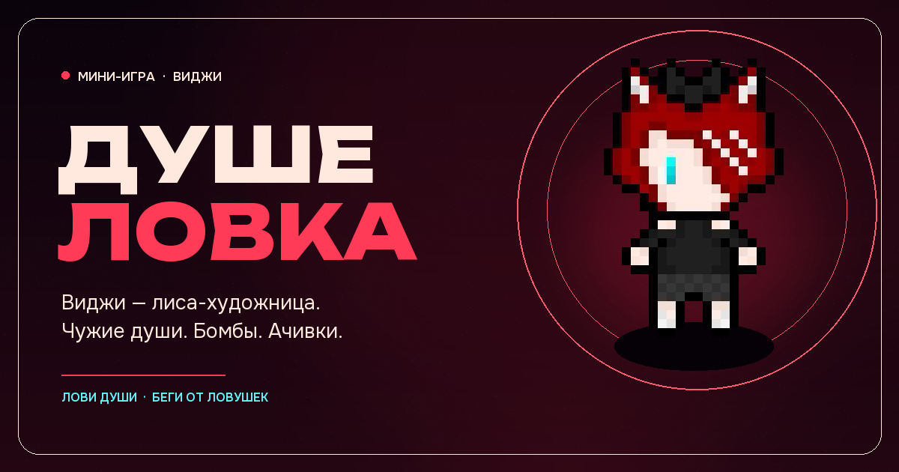

# Душеловка

Маленькая браузерная аркада про **Виджи** — рыжую лису-художницу, которая ловит чужие души и уворачивается от неприятностей. Теперь с гостевыми скинами, магазином и локальной таблицей лидеров.

Одна HTML-страница, без сборки и зависимостей: чистые Canvas, CSS и JavaScript. Работает мышью, пальцем и с клавиатуры.



## Что внутри

- 15 достижений с сохранением прогресса в браузере.
- **Души** как валюта: +1 за каждую пойманную искру.
- **Магазин скинов** с лором пяти гостевых персонажей.
- **Локальный топ-10** забегов: счёт, волна, скин и дата.
- Бомбы и кости: отнимают очки, но **не жизни**.
- Черепа и чёрные сердца: дебафы, от которых защищает щит.
- Щит на 10–20 секунд, песочные часы и ложное сердце.
- Бонусы: звезда даёт двойные очки, кисть включает магнит.
- Комбо до `×5`, волны с ускорением, рекорд в `localStorage`.
- Профиль-хаб Виджи: лор, достижения, магазин и лидеры.
- Адаптив под телефон и десктоп, звук на Web Audio, `prefers-reduced-motion`.

## Как играть

- Двигайте персонажа мышью, пальцем или клавишами `←` / `→` (`A` / `D`).
- Ловите синие души: серия повышает множитель до `×5`, а каждая душа даёт +1 к балансу магазина.
- Красные черепа отнимают сердце. Три сердца — три ошибки.
- Бомбы и кости снимают очки: бомба ещё и сбрасывает комбо.
- **Щит** на 10–20 секунд блокирует черепа, бомбы, кости и чёрные сердца.
- **Песочные часы** останавливают падение дебафов на 10 секунд.
- **Чёрное (ложное) сердце** ускоряет падение дебафов в 3 раза на 10 секунд.
- Звезда (`★`) удваивает очки за души на 8 секунд, кисть включает магнит на 8 секунд.
- Розовые сердца восстанавливают жизнь; на полном здоровье дают бонусные очки.
- `P` / `Esc` — пауза. `Space` / `Enter` — начать или продолжить.
- Кнопка **ВИДЖИ** в левом нижнем углу открывает хаб. На стартовом экране также есть быстрые ссылки **магазин** и **лидеры**.

## Скины и магазин

Баланс душ и покупки сохраняются в браузере. Купленный скин сразу выбирается; сменить его можно в любой момент.

| Скин | Цена | Лор |
| --- | ---: | --- |
| Виджи | бесплатно | Лиса-художница с рожками и синим глазом. |
| Ламия | 25 | Сонная ламия, которая ловит души даже во сне. |
| Вэлма | 40 | Рогатая стримерша, идущая навстречу страху хорроров. |
| Аки Гору | 60 | Тёмная эльфийка, художница и любительница TES и Animal Crossing. |
| Шиппи Оз | 80 | Белая овечка, отзывающаяся почти на любое имя. |
| Багуля | 100 | Гостья из 2007 года, любительница осенних страшилок. |

Ссылки на Twitch каждого персонажа есть в карточках магазина.

- [Ламия](https://www.twitch.tv/lamiyumi)
- [Вэлма](https://www.twitch.tv/your_valma)
- [Аки Гору](https://www.twitch.tv/aki_goru)
- [Шиппи Оз](https://www.twitch.tv/sheeppyoz)
- [Багуля](https://www.twitch.tv/bagulya_play)

Гостевые арты: **Артём Юрченко** — [@FieryHeart66](https://t.me/FieryHeart66). Исходный арт Виджи принадлежит Виджи.

## Таблица лидеров

Таблица локальная: топ-10 забегов хранится в `localStorage` этого браузера. В строке видны скин, счёт, волна и дата. Глобального сервера у статической GitHub Pages-версии нет.

## Лор

**Виджикс / Виджи / Ви (Тайлорн)** — 16 лет, лиса, художница, тип личности ISFP. Рыжая, с рожками и очень синим глазом; рисует, ловит вдохновение и иногда — чужие души.

- Лор и стримы: [@wydjxk_vt](https://t.me/wydjxk_vt)
- Арт-канал: [@wydjxkk](https://t.me/wydjxkk)
- Карточка персонажа: [@personashiki_wyd/5](https://t.me/personashiki_wyd/5)

Персонаж и исходный арт принадлежат Виджи. Код игры написан для этого репозитория.

## Локальный запуск

Из корня проекта:

```bash
python -m http.server 8000
```

Затем откройте `http://localhost:8000/`.

Можно открыть и просто через `index.html`, но локальный сервер лучше: так браузер гарантированно загрузит шрифты и спрайт.

## Публикация на GitHub Pages

Репозиторий: <https://github.com/Bell-igor/-x->

Публикация настроена через GitHub Actions. При каждом пуше в `main` workflow
[`pages.yml`](.github/workflows/pages.yml) собирает статическую папку `_site` и выкладывает её на GitHub Pages.

Готовая игра:

<https://bell-igor.github.io/-x-/>

Прогресс публикации можно смотреть во вкладке **Actions** репозитория. Если Pages нужно настроить вручную, выберите в **Settings → Pages** источник **GitHub Actions**.

## Структура

```text
.
├── index.html          # разметка и SVG-иконки
├── style.css           # оформление, адаптив, анимации
├── game.js             # игровой цикл, физика, звук, рекорды, ачивки
├── .github/
│   └── workflows/
│       └── pages.yml   # публикация на GitHub Pages
└── assets/
    ├── hero.png        # спрайт Виджи с прозрачным фоном
    ├── skins/          # гостевые скины: Ламия, Вэлма, Аки, Шиппи, Багуля
    ├── favicon.svg
    ├── og.png          # превью для соцсетей
    └── fonts/          # Unbounded + Onest
```

## Технические детали

- Игровое поле масштабируется под экран и учитывает `devicePixelRatio`.
- Спрайты и эффекты рисуются на Canvas с nearest-neighbour масштабированием.
- Достижения, души, купленные скины, выбранный скин и топ-10 хранятся в `localStorage`; при отключённом хранилище игра продолжает работать.
- Звук синтезируется через Web Audio API, без внешних аудиофайлов.
- Внешних запросов и аналитики нет: всё работает офлайн после загрузки. Ссылки на Twitch и Telegram открываются только по клику.
